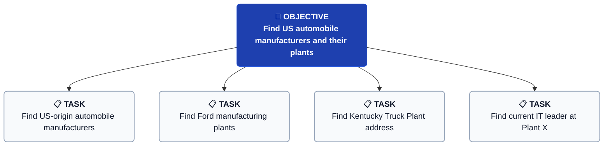
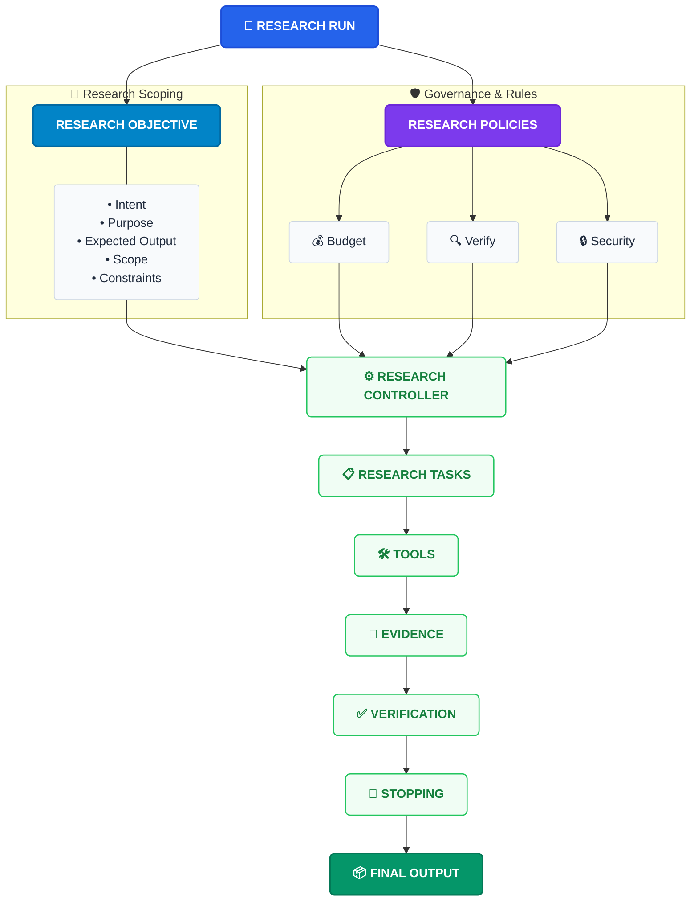

# Research Objective & Execution Architecture

## 1. Research Query Example

> [!NOTE]
> **Sample User Prompt:**  
> *"Research the US-origin automotive/automobile manufacturing industry. Identify relevant manufacturers and their US manufacturing plants. For each plant, find their head, tech lead, and their contact information."*

---

## 2. Objective Hierarchy & Task Decomposition

The high-level research objective is recursively decomposed into targeted, executable research tasks.

### Visual Hierarchy



### Tree View

```text
OBJECTIVE
Find US automobile manufacturers and their plants
 │
 ├── TASK
 │   Find US-origin automobile manufacturers
 │
 ├── TASK
 │   Find Ford manufacturing plants
 │
 ├── TASK
 │   Find Kentucky Truck Plant address
 │
 └── TASK
     Find current IT leader at Plant X
```

---

## 3. Core Research Dimensions

Every research objective is scoped and evaluated across six fundamental dimensions:

| Dimension | Core Question | Description & Focus |
| :--- | :--- | :--- |
| **Target** | *What is being searched?* | The specific entities, industry sectors, or information targets. |
| **Rationale** | *Why is it being searched?* | The intent, motivation, and underlying goal of the query. |
| **Decomposition** | *How will it be broken down?* | The strategy for partitioning the objective into atomic, executable tasks. |
| **Deliverables** | *What are the expected answers/results?* | The required schema, entity attributes, and output structure. |
| **Validation** | *How will results be verified?* | Provenance tracking, source corroboration, and accuracy checks. |
| **Boundaries** | *What constraints and rules exist?* | Budget limits, source policies, security rules, and exploration caps. |

---

## 4. Research Run Lifecycle & Architecture

The execution architecture coordinates the research run from objective intake and policy enforcement through tool orchestration, evidence collection, verification, and final output generation.

### Architecture Flowchart



### Architecture Diagram (ASCII)

```text
                    RESEARCH RUN
                         │
        ┌────────────────┴────────────────┐
        │                                 │
        ▼                                 ▼
RESEARCH OBJECTIVE                RESEARCH POLICIES
        │                                 │
        │                         ┌───────┼────────┐
        │                         ↓       ↓        ↓
        │                      Budget  Verify   Security
        │
        ├── Intent
        ├── Purpose
        ├── Expected Output
        ├── Scope
        └── Constraints
                         │
                         ▼
                 RESEARCH CONTROLLER
                         │
                         ▼
                  RESEARCH TASKS
                         │
                         ▼
                      TOOLS
                         │
                         ▼
                    EVIDENCE
                         │
                         ▼
                   VERIFICATION
                         │
                         ▼
                     STOPPING
                         │
                         ▼
                    FINAL OUTPUT
```

---

## 5. Pipeline Component Reference

- **Research Run:** The top-level orchestration lifecycle managing the entire investigation.
- **Research Objective:** Formalizes the prompt into structured intent, purpose, expected schema, scope, and constraints.
- **Research Policies:** Enforces operational guardrails across resource budget (tokens/time/requests), verification thresholds, and security/safety limits.
- **Research Controller:** The central engine that coordinates task creation, dispatch, and state tracking.
- **Research Tasks:** Individual atomic actions generated dynamically to address knowledge gaps.
- **Tools:** Search engines, web fetchers, document parsers, and scrapers used to gather raw context.
- **Evidence:** Extracted claims, entities, relationships, and source citations.
- **Verification:** Corroboration engine checking evidence consistency, source credibility, and conflict detection.
- **Stopping Condition:** Criteria evaluation to determine if research goals are satisfied or limits are reached.
- **Final Output:** Structured, verified knowledge dataset (JSON, SQLite, reports) with full provenance.