# Heimdallr Architecture & Dependency Map
**Repository**: `Argus / Heimdallr Core Intelligence Platform`  
**Audit Date**: October 2026  
**Auditor**: Principal Systems Architect & Adversarial Engineering Reviewer  
**Status**: Complete, Verified Against Live Implementation

---

## 1. Executive Subsystem Inventory

The Heimdallr codebase comprises two integrated intelligence engines operating across a shared storage and specialist tier:
1. **Argus Classic Research Engine (`src/argus/`)**: A task-graph-driven OSINT research framework utilizing System 1 planning (`src/argus/brain`), worker execution (`src/argus/worker`), web crawling (`src/argus/crawler`), search provider aggregation (`src/argus/search`), and SQLite persistence (`src/argus/storage`).
2. **Investigation Engine V2/V3 (`src/argus/investigation/`)**: An objective-driven epistemic inquiry engine driven by `InvestigationOrchestrator`, `InvestigationPlanner`, `InvestigationStoppingPolicy`, and dynamic information-gain calculation over `InvestigationState`.
3. **Capability Registry & Matcher (`src/argus/capability_registry/`, `src/argus/competition/`)**: Deterministic capability discovery, fail-closed registration, minimum-sufficient-set matching, and implementation selection with runtime security gating (`SecurityGateValidator`).
4. **Recruited Specialist Intelligence Suite (`src/argus/specialists/`)**:
   - **Corporate Intelligence (`src/argus/specialists/corporate/`)**: SEC filings, corporate registries, officer tenures, and temporal jurisdiction modeling.
   - **Infrastructure Intelligence (`src/argus/specialists/infrastructure/`)**: Passive DNS, Certificate Transparency (CT logs), ASN/IP geolocation, and hosting telemetry.
   - **Identity Intelligence (`src/argus/specialists/identity/`)**: Deterministic Cleanroom identity resolution, cross-platform username/pseudonym correlation, and alias tracking.
   - **Sanctions & Offshore Intelligence (`src/argus/specialists/sanctions/`)**: OFAC, EU, UN, UK sanctions matching, offshore corporate structures (ICIJ/Panama Papers), and PEP tracking.
   - **Dark Web & Onion Intelligence (`src/argus/specialists/onion/`)**: Tor hidden service crawling, PGP key extraction, cryptographic fingerprinting, and forum indexing.
   - **Email & Account Intelligence (`src/argus/specialists/email/`)**: Domain MX/SPF/DKIM validation, disposable provider detection, account enumeration, and epistemic email-to-identity linkage.
5. **Epistemic Verifier & Truth Engine (`src/argus/verifier/`)**: Cross-source corroboration, contradiction resolution, syndication detection, and point-in-time temporal assertion.

---

## 2. End-to-End System Dependency Graph

```mermaid
graph TD
    User([User Objective / CLI Entrypoint]) --> Orch[InvestigationOrchestrator]
    Orch --> Plan[InvestigationPlanner]
    Plan --> Match[CapabilityMatcher]
    Match --> Reg[CapabilityRegistry]
    Plan --> Sel[ImplementationSelector]
    Sel --> Reg
    
    Orch --> Gate[SecurityGateValidator]
    Gate --> Adapters[Capability Adapters]
    
    subgraph Specialists [Specialist Tier]
        Adapters --> SpecCorp[CorporateSpecialist]
        Adapters --> SpecInfra[InfrastructureSpecialist]
        Adapters --> SpecIdent[IdentitySpecialist]
        Adapters --> SpecSanc[SanctionsSpecialist]
        Adapters --> SpecOnion[OnionSpecialist]
        Adapters --> SpecEmail[EmailAccountSpecialist]
    end
    
    subgraph SharedInfra [Shared Infrastructure & Search]
        SpecCorp --> CorpCorpus[(Corporate SEC/Registry)]
        SpecInfra --> InfraDNS[(DNS / CT Logs)]
        SpecOnion --> TorProxy[(Tor SOCKS5 / Index)]
        SpecEmail --> EmailVal[EmailValidator & Providers]
        Orch --> SearchPipe[SearchPipeline]
        SearchPipe --> DDG[DuckDuckGoProvider]
        SearchPipe --> Searx[SearXNGProvider]
        SearchPipe --> FourChan[FourChanSearchProvider]
        SearchPipe --> Crawler[CrawlEngine & Fetcher]
    end

    Specialists --> Gate
    Gate --> Verifier[Epistemic VerifierEngine]
    Verifier --> Temp[TemporalReasoner]
    Verifier --> Synd[SyndicationIntelligence]

    Verifier --> State[InvestigationState]
    State --> Stop[InvestigationStoppingPolicy]
    State --> Gain[InformationGainEvaluator]
    
    State --> Store[InvestigationStore JSON/JSONL]
    State --> Repo[ArgusRepository SQLite]
```

---

## 3. Component Ownership, Contracts, and Failure Domains

| Subsystem | Primary Module | Data Owned | External Invocations | Failure Boundary & Isolation | Mandatory vs Optional |
| :--- | :--- | :--- | :--- | :--- | :--- |
| **Investigation Orchestrator** | `argus.investigation.orchestrator` | `InvestigationState`, Research Loop | Adapters, Corpus, Search | Fails closed; writes audit entry and stops with error status | Mandatory |
| **Investigation Planner** | `argus.investigation.planner` | Question DAG, Action Queues | Matcher, Selector | Degrades to general web search actions if no specialist matched | Mandatory |
| **Capability Registry** | `argus.capability_registry.registry` | Capability & Implementation catalog | File storage (JSON) | In-memory indexing; rejects invalid definitions fail-closed | Mandatory |
| **Capability Matcher** | `argus.capability_registry.matcher` | Capability Candidates | Regex / Taxonomy Engine | Empty match falls back to General Research capability | Mandatory |
| **Implementation Selector** | `argus.competition.implementation_selector` | Ranked Implementations | Registry query | Selects highest-health / highest-score implementation | Mandatory |
| **Security Gate** | `argus.competition.security_gate` | Observation Sanitization | None (Pure Python) | Neutralizes prompt injection & defuses HTML/scripts | Mandatory |
| **Corporate Specialist** | `argus.specialists.corporate` | Company Profiles, Filings | SEC EDGAR, Corp DBs | Returns empty profile with `NOT_FOUND` / `INSUFFICIENT_EVIDENCE` | Optional |
| **Infrastructure Specialist**| `argus.specialists.infrastructure` | DNS, IP, SSL, CT records | CT log APIs, DNS resolvers | Times out gracefully on network failure | Optional |
| **Identity Specialist** | `argus.specialists.identity` | Cleanroom identity graphs | Public username scrapers | Fails closed without merging on ambiguous candidates | Optional |
| **Sanctions Specialist** | `argus.specialists.sanctions` | Sanctioned entities, Offshore | OFAC/EU lists, ICIJ | Offline fallback to static snapshots | Optional |
| **Onion Specialist** | `argus.specialists.onion` | Hidden service extractions | SOCKS5 Tor Proxy | Fails with `PROXY_UNAVAILABLE` without crashing caller | Optional |
| **Email Specialist** | `argus.specialists.email` | Account presence, MX/SPF | DNS MX, Gravatar/Social | Non-blocking socket timeouts; returns partial accounts | Optional |
| **Epistemic Verifier** | `argus.verifier.engine` | Verification Verdicts | None (Corpus + Graph) | Strips uncorroborated syndications; sets claim confidence | Mandatory |
| **Investigation Store** | `argus.investigation.store` | `state.json`, `audit.jsonl` | Local Filesystem | Atomic `.tmp` rename; path traversal sanitization | Mandatory |
| **Argus Repository** | `argus.storage.repository` | Relational Entity Graph | SQLite Database | SQLite transactional rollback on integrity error | Mandatory |

---

## 4. Architectural Inconsistencies & Anti-Patterns Identified

### Anti-Pattern 1: Hardcoded Ground-Truth Benchmark Leakage (`orchestrator.py`)
- **Location**: `src/argus/investigation/orchestrator.py` lines 425–445.
- **Pattern**: When executing queries matching `Apex Technologies Group`, the orchestrator imported `APEX_20_EXECUTIVES` directly from `argus.investigation.benchmark.corpus` and injected pre-fabricated ground truth claims into `state.claims` instead of extracting them from evidence passages.
- **Impact**: Bypasses document extraction and verifier scrutiny during the 20-executive benchmark run.
- **Remediation Plan**: Documented in Remediation Report as P1 defect `DEFECT-LEAK-01`.

### Anti-Pattern 2: 100% Duplicate Document Acquisition (`orchestrator.py` vs Adapters)
- **Location**: `src/argus/investigation/orchestrator.py` lines 380–415.
- **Pattern**: Orchestrator executed `adapter.execute(inputs, corpus=self.corpus)`, which retrieved and formatted documents into `result["documents"]`. Immediately afterward, the orchestrator called `self.corpus.search(action.query)` and appended the identical documents a second time.
- **Impact**: Doubled token consumption, bloated in-memory evidence lists by 100%, and triggered duplicate LLM extraction requests.
- **Resolution**: **Fixed and verified** via `DEFECT-PERF-01` and URL/snippet deduplication in `InvestigationState.add_evidence`.

### Anti-Pattern 3: O(N²) Audit Trail Rewrites (`store.py`)
- **Location**: `src/argus/investigation/store.py` line 65.
- **Pattern**: `append_audit_log` opened `_audit.jsonl` in append mode (`"a"`) and iteratively wrote out all `state.audit_trail` entries on every investigation step. Since `state.audit_trail` retains all prior steps, step 1 wrote 1 entry, step 2 wrote 2 entries, ..., step 15 wrote 15 entries, producing duplicate log lines and quadratic file bloat.
- **Resolution**: **Fixed and verified** via `DEFECT-PERS-02` by tracking seen `entry_id`s and appending only new delta entries.

### Anti-Pattern 4: Unhandled Null Contract Across Adapters
- **Location**: `src/argus/specialists/email/resolution.py` line 39.
- **Pattern**: Adapters assumed callers always passed non-empty dictionary keys (e.g. `inputs["target_identity"]`). When invoked by generic planners with just `{"query": "..."}`, `target_identity.strip()` threw unhandled `AttributeError`.
- **Resolution**: **Fixed and verified** via `DEFECT-INT-01`.

---

## 5. Architectural Quality Scorecard

| Criterion | Evaluation | Justification |
| :--- | :---: | :--- |
| **Separation of Concerns** | **Strong (4.5/5)** | Clean separation between Planning, Matching, Specialized Intelligence, and Epistemic Verification. |
| **Contract Rigor** | **Substantial (4.0/5)** | Strong Pydantic models in Capability Registry and Investigation State, improved by null-safe adapter boundaries. |
| **Fault Isolation** | **High (4.8/5)** | Specialist network/scraping failures never terminate the parent investigation; fail-closed defaults preserved. |
| **Persistence Integrity** | **High (4.7/5)** | Atomic filesystem writes and SQLite transactional merging prevent partial-write state corruption. |
