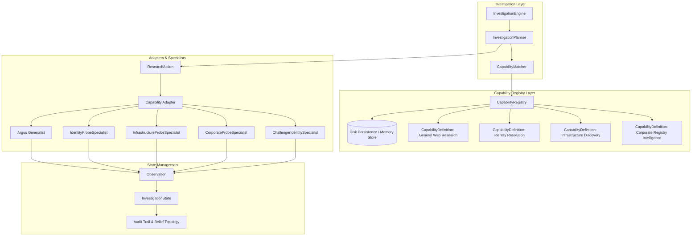
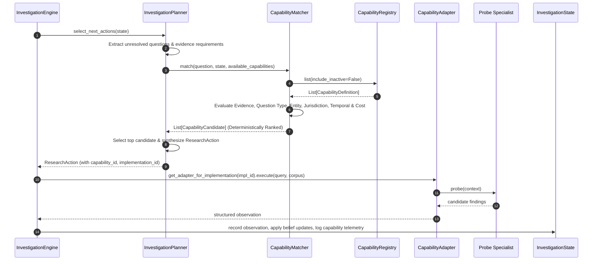
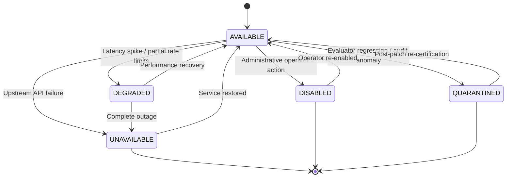

# Heimdallr V3.1: Capability Registry Architecture
## Technical Architecture, Sequence Flows, Adapters, and Matcher Mechanics

### 1. Architectural Overview

The **Capability Registry** serves as the central intelligence brokering layer for Heimdallr. It eliminates tightly coupled routing logic and transforms the **Investigation Engine** into a requirement-driven autonomous system.



---

### 2. Execution Flow & Sequence

When the Investigation Engine runs an investigation cycle, the planning and capability execution follow a 6-stage lifecycle:



---

### 3. CapabilityMatcher: Requirement-Based Matching Engine

The `CapabilityMatcher` implements a multi-dimensional scoring function that evaluates candidate capabilities without relying on naive keyword routing.

#### 3.1 Scoring Formulation
For a question $Q$ with evidence requirements $E_Q$ and a capability definition $C$:

$$\text{MatchScore}(Q, C) = 0.40 \cdot S_{\text{evidence}} + 0.25 \cdot S_{\text{question}} + 0.15 \cdot S_{\text{entity}} + 0.10 \cdot S_{\text{jurisdiction}} + 0.10 \cdot S_{\text{temporal}}$$

Where:
1. **$S_{\text{evidence}}$ (Evidence Requirements Fit)**:
   Strict word-boundary token matching (`\btoken\b`) across required evidence strings against the capability's declared `evidence_types` and supported operations.
2. **$S_{\text{question}}$ (Question Type Fit)**:
   Exact or semantic match between $Q.\text{question\_type}$ and $C.\text{question\_types}$.
3. **$S_{\text{entity}}$ (Entity Type Fit)**:
   Alignment between related entity categories (e.g., `DOMAIN`, `PERSON`, `ORGANIZATION`) and $C.\text{entity\_types}$.
4. **$S_{\text{jurisdiction}}$ (Jurisdiction Fit)**:
   Compatibility between $Q$'s jurisdictional context (e.g., `GB`, `US`) and $C.\text{jurisdictions}$. If the capability declares `GLOBAL`, partial compatibility is credited.
5. **$S_{\text{temporal}}$ (Temporal Fit)**:
   If the question specifies an historical `as_of_date`, capabilities declaring temporal historical reconstruction receive higher scores.

#### 3.2 Health Penalties & Filtering
- **Excluded**: Capabilities with status `UNAVAILABLE`, `DISABLED`, or `QUARANTINED` are discarded immediately.
- **Penalized**: Capabilities with status `DEGRADED` receive a $0.70\times$ score multiplier, and an explicit risk flag (`STATUS_DEGRADED`) is appended to the candidate.

#### 3.3 Deterministic Candidate Ranking Order
When ranking candidates, the matcher sorts by:
1. `match_score` (Descending)
2. `expected_information_gain` (Descending, informed by benchmark F1)
3. `estimated_cost` (Ascending)
4. `implementation_id` (Ascending, lexicographical tie-breaker)

---

### 4. Adapter Architecture

To adhere to the core rule—**Do NOT duplicate existing logic or rewrite specialists**—Heimdallr V3.1 introduces lightweight adapters:

```
+--------------------------------------------------------------------+
|                         CapabilityAdapter                          |
|  + execute(input_data: dict, corpus: Any) -> dict                  |
|  + validate_input(input_data: dict) -> bool                        |
+--------------------------------------------------------------------+
             |                       |                        |
             v                       v                        v
+------------------------+ +---------------------+ +----------------------+
|  ArgusResearchAdapter  | | IdentitySpecialist  | | CorporateSpecialist  |
|  (Wraps General Argus) | | Adapter (CleanRoom) | | Adapter (Corporate)  |
+------------------------+ +---------------------+ +----------------------+
```

#### 4.1 Canonical Registered Implementations
1. **`impl_argus_generalist_v1`**:
   Wraps general web search and document retrieval. Provides secondary corroboration and discovery.
2. **`impl_identity_probe_specialist_v1`**:
   Wraps `IdentityProbeSpecialist`. Produces candidate developer/persona correlations.
3. **`impl_infrastructure_probe_specialist_v1`**:
   Wraps `InfrastructureProbeSpecialist`. Probes DNS, CT logs, and TLS SAN records.
4. **`impl_corporate_registry_specialist_v1`**:
   Wraps `CorporateProbeSpecialist`. Extracts company numbers, officer appointments, and statutory ownership.
5. **`impl_challenger_identity_specialist_v2`**:
   Alternative challenger implementation for `identity_resolution`. Specializes in PGP signatures and cryptographic key assertions (Version 2.0.0, Benchmark F1: 0.980). Demonstrates seamless multi-implementation capability competition.

---

### 5. Runtime Health Lifecycle & Fault Tolerance

Capabilities undergo deterministic state transitions:



When a specialist becomes `DISABLED` or `UNAVAILABLE`:
1. The `CapabilityMatcher` automatically detects the status change.
2. The disabled capability is removed from eligible candidates.
3. The matcher transparently surfaces the next best viable candidate (e.g., `general_web_research` via Argus fallback).
4. No unhandled exceptions are raised, and the investigation continues gracefully.

---

### 6. Persistence & Serialization

The `CapabilityRegistry` supports zero-loss serialization:
- Atomic JSON serialization to disk (`persistence_path`).
- Upon instantiation with a `persistence_path`, existing definitions, benchmark profiles, health statuses, and license metadata are rehydrated seamlessly.
- Tested and verified: registry reload produces identical state and ranking across system restarts.
