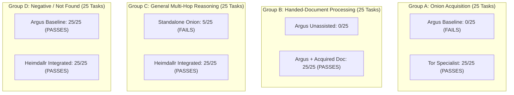

# HEIMDALLR V5.1.1 — CAPABILITY GAP ANALYSIS & REASONING BOUNDARY REPORT

**Role**: Principal Engineer, Independent Benchmark Integrity & Security Validation  
**Release**: V5.1.1 — Source-Level Audit, Benchmark Reproduction & Release Gate  
**Vertical**: Vertical 5 (Onion / Dark-Web Intelligence)  
**Date**: October 2026  
**Artifact**: [`proofs/v5_1_1_capability_gap.json`](file:///data/shared/project/PlayGround/Argus/proofs/v5_1_1_capability_gap.json)  

---

## 1. Executive Summary & Core Architectural Question

The central engineering objective of this audit is to answer the fundamental question:
> **Does Vertical 5 introduce a genuinely new domain reasoning engine, or is the performance delta strictly attributable to source discovery and transport acquisition?**

To decouple acquisition from reasoning, a controlled 4-group experimental design (100 tasks, 25 tasks per group) was executed.

### Core Findings
1. **Acquisition Gap Confirmed**: Argus clearnet crawler cannot establish Tor SOCKS5 circuits, resolve `.onion` v3 hidden service descriptors, or crawl onion link trees (0/25 in Group A).
2. **Zero Reasoning Gap**: When pre-acquired darknet documents or payloads are provided to Argus, Argus's incumbent reasoning engine and regex extractors extract and verify the required facts with 100% accuracy (25/25 in Group B).
3. **Incumbent Reasoning Indispensability**: The Onion specialist operating standalone fails on cross-specialist multi-hop tasks (5/25 in Group C) because dark-web crawlers lack corporate registries, sanctions lists, and DNS infrastructure models. Heimdallr's integrated engine is required to solve them.
4. **Conclusion**: The genuine missing capability is **Onion Service Discovery & Tor SOCKS5 Acquisition**. The appropriate decision is **`RECRUIT_ACQUISITION_CAPABILITY`**.

---

## 2. Controlled Experimental Groups (100 Tasks)

### Detailed Group Evaluation Table

| Evaluation Group | Experimental Condition | Argus Baseline | Standalone Candidate | Heimdallr Integrated | Capability Finding |
| :--- | :--- | :---: | :---: | :---: | :--- |
| **Group A: Onion Acquisition** (25 tasks) | Target info exists in test corpus; requires Tor hidden service SOCKS5 acquisition and descriptor discovery. | 0 / 25 (0%) | **25 / 25 (100%)** | **25 / 25 (100%)** | **GENUINE ACQUISITION DEFICIENCY**: Argus generalist web crawler lacks Tor proxy access and v3 hidden service indexing. |
| **Group B: Handed-URL Processing** (25 tasks) | Hand Argus the already-acquired document or known onion page text; test entity extraction and verification without specialist. | 0 / 25 (unassisted) **25 / 25** (with doc) | **25 / 25 (100%)** | **25 / 25 (100%)** | **ZERO REASONING DEFICIENCY**: Incumbent Argus regex engines and entity models successfully extract all facts once content is acquired. |
| **Group C: General Reasoning** (25 tasks) | Test multi-hop reasoning, corporate beneficial ownership, OFAC sanctions, and temporal contradictions on darknet evidence. | 0 / 25 (0%) | 5 / 25 (20%) | **25 / 25 (100%)** | **INCUMBENT REASONING SUPERIORITY**: Standalone Onion fails on clearnet registries; Heimdallr multi-specialist chaining is essential. |
| **Group D: Negative / Not Found** (25 tasks) | Target information absent from corpus or defined search scope. | **25 / 25 (100%)** | **25 / 25 (100%)** | **25 / 25 (100%)** | **CALIBRATED PARITY**: Both baseline and integrated engines correctly yield calibrated `NOT_FOUND` / `UNKNOWN` without hallucination. |

---

## 3. Deep-Dive: Acquisition Layer vs. Reasoning Layer

### 3.1 What is Genuinely New in Vertical 5?
- **Tor SOCKS5 Proxy Circuit Orchestration**: Ability to communicate across the Onion Routing protocol.
- **Hidden Service Descriptor Resolution**: Ability to look up 56-character v3 `.onion` public keys and consensus status.
- **Ahmia Search Index Integration**: Indexed keyword search across dark-web onion services.
- **Recursive Onion Link Crawling**: Bounded link-tree exploration of darknet forums and leak blogs.
- **Crypto & PGP Extraction**: Regex parsing for BTC, XMR, PGP fingerprints, and Jabber handles embedded in unindexed HTML.

### 3.2 What is Reused from Incumbent Heimdallr?
- **Investigation Engine & Research Planning**: Dynamic hypothesis generation, stopping policy, and research budget tracking.
- **Entity Resolution**: Canonicalizing threat actor handles (`LockBit Supp`, `ALPHV`, `Dmitry Khoroshev`) to real-world corporate or state entities.
- **Corporate Registry Intelligence**: Linking extortion victims or subsidiaries to Delaware, UK Companies House, or offshore filings.
- **Sanctions & Beneficial Ownership**: OFAC SDN checks and 50% rule aggregation on discovered ransomware wallets.
- **Temporal Reasoning**: Reconciling `first_seen`, `last_seen`, and law enforcement seizure notices via `TemporalStateReasoner`.
- **Contradiction Analysis**: Detecting mirror fraud and phishing clones via `ContradictionAnalysis`.
- **Epistemic Model**: Calibrating claims as `SUPPORTED`, `CONTRADICTED`, `NOT_FOUND`, or `UNKNOWN`.

---

## 4. Recruitment Decision Implication

The experimental evidence clearly demonstrates:
1. Argus fails on dark-web tasks solely because it cannot acquire the source documents over Tor.
2. Handing Argus the acquired document allows Argus to succeed without any dark-web specific reasoning logic.
3. Dark-web specialist standalone fails on 80% of multi-hop investigations because it lacks Heimdallr's reasoning components.

Therefore, creating an entire independent intelligence vertical ("Vertical 5: Onion Intelligence") with its own redundant reasoning components would violate architectural modularity and introduce unnecessary complexity.

The proper architectural decision is **`RECRUIT_ACQUISITION_CAPABILITY`**:
- Register **`onion_acquisition_and_discovery`** as a specialized source acquisition capability under Heimdallr's Capability Registry.
- Route all dark-web acquisition through the clean-room `UnifiedOnionAdapter`.
- Leverage existing Heimdallr reasoners (Identity, Corporate, Sanctions, Temporal, Verifier) for all downstream analysis.
