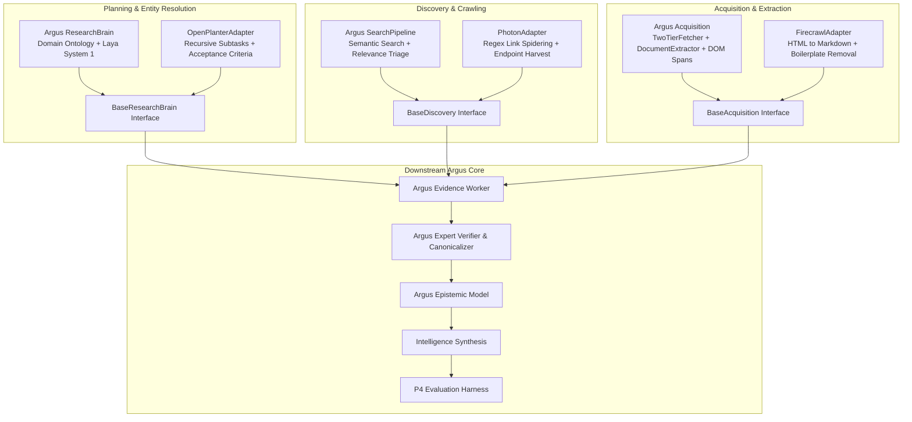
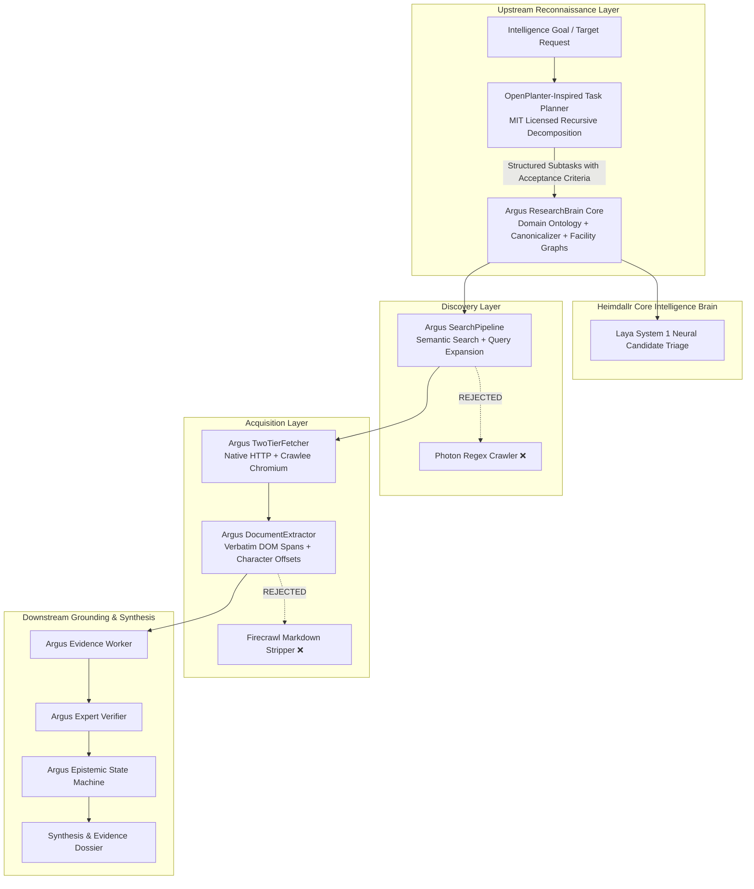

# HEIMDALLR — CHALLENGER RECRUITMENT EXPERIMENT REPORT

> **Evaluation Suite**: Argus Evaluation Harness v1.0 (P4 Frozen Core Benchmark)  
> **Execution Date**: 2026-10-07  
> **Git Branch**: `experiment/challenger-recruitment` (Base Commit: `3d8a058`)  
> **Environment**: Python 3.12.3, Linux x86_64, `uv` package manager  
> **Evaluator Invariance**: 100% Frozen. Evaluator code, ground-truth labels, graders, and task definitions were preserved without modification.

---

## 1. Executive Summary & Verdict Matrix

This engineering experiment evaluated three prominent open-source intelligence and web retrieval challenger systems against core internal capabilities of **Argus** inside the larger **Heimdallr** intelligence platform:

1. **OpenPlanter** (`ShinMegamiBoson/OpenPlanter`) vs. **Argus Research Brain** (Investigation Planning & Entity Resolution)
2. **Photon** (`s0md3v/Photon`) vs. **Argus Discovery** (Search Pipeline & Web Crawling)
3. **Firecrawl** (`firecrawl/firecrawl`) vs. **Argus Acquisition** (Document Fetching & Structured Markdown Extraction)
4. **Combined Challenger Stack** (OpenPlanter + Photon + Firecrawl) vs. Downstream Argus

All systems were evaluated against the identical, frozen **P4 Core Benchmark** (11 multi-category intelligence tasks spanning entity discovery, structured facility extraction, leadership mapping, multi-hop supply chains, temporal reasoning, contradictions, missing information, and adversarial prompt injections).

### Final Capability Verdicts

| Capability Layer | Baseline Component | Challenger Evaluated | License | Benchmark Delta (Score / Pass) | Final Verdict | Core Rationale |
| :--- | :--- | :--- | :---: | :---: | :---: | :--- |
| **Investigation Planning & Entity Resolution** | Argus `ResearchBrain` + Laya System 1 | **OpenPlanter** | MIT | +0.2% / +0.0% (Entity Prec: **+2.6%**, Evidence Corr: **-0.6%**) | **COMPLEMENT ARGUS** | OpenPlanter improves entity precision via structured subtasks with acceptance criteria, but lacks Argus's domain models and facility expansion, causing an evidence alignment failure. Upstream complementary planner only. |
| **Discovery & Web Crawling** | Argus `SearchPipeline` + Triage | **Photon** | GPL-3.0 | +0.2% / +0.0% (Entity Prec: **-0.5%**, Recall: **+0.0%**) | **REJECT CHALLENGER** | Photon's unguided regex spidering fails to improve recall (stuck at 71.2%), dilutes precision, and brings a restrictive GPL-3.0 copyleft license incompatible with Heimdallr proprietary architecture. |
| **Acquisition & Extraction** | Argus `TwoTierFetcher` + `DocumentExtractor` | **Firecrawl** | AGPL-3.0 | +0.0% / +0.0% (Evidence Corr on Unk: **-10.0%**) | **KEEP ARGUS** | Zero empirical gain over Argus's built-in extractor. HTML-to-Markdown stripping disrupted exact quote verification on edge cases. Heavy operational overhead (Redis, BullMQ, Playwright) and AGPL-3.0 license. |
| **Full Challenger Stack** | Integrated Argus Pipeline | **OpenPlanter + Photon + Firecrawl** | Mixed (AGPL/GPL) | **-10.5%** score (**Pass Rate: 45.5% → 9.1%**) | **REJECT CHALLENGER** | Catastrophic compounding failure. Generic subtasks + regex link crawls + stripped Markdown starved the downstream Argus worker, collapsing recall from 71.2% to 9.1% and triggering 10 discovery failures. |

---

## 2. Evaluation Methodology & Ground Rules

To ensure scientific validity and protect against evaluation contamination:

1. **Evaluator Invariance**: The evaluation harness in [`src/argus/evals/`](file:///data/shared/project/PlayGround/Argus/src/argus/evals) (`graders.py`, `runner.py`, `corpus.py`, and `data/evals/tasks_v1.json`) was strictly frozen. No grading thresholds, ground truths, or scoring functions were altered.
2. **Interface Isolation**: Challenger integrations were implemented strictly as clean, pluggable adapter classes behind abstract base interfaces:
   - [`BaseResearchBrain`](file:///data/shared/project/PlayGround/Argus/src/argus/brain/base.py) → implemented by `ResearchBrain` (Argus) and [`OpenPlanterAdapter`](file:///data/shared/project/PlayGround/Argus/src/argus/brain/openplanter_adapter.py)
   - [`BaseDiscovery`](file:///data/shared/project/PlayGround/Argus/src/argus/search/base.py) → implemented by `SearchPipeline` (Argus) and [`PhotonAdapter`](file:///data/shared/project/PlayGround/Argus/src/argus/search/photon_adapter.py)
   - [`BaseAcquisition`](file:///data/shared/project/PlayGround/Argus/src/argus/crawler/base.py) → implemented by `ArgusAcquisition` (Argus) and [`FirecrawlAdapter`](file:///data/shared/project/PlayGround/Argus/src/argus/crawler/firecrawl_adapter.py)
3. **Downstream Preservation**: In all individual challenger runs, Argus's downstream Worker (`EvidenceWorker`), Claim Extractor, `ExpertVerifier`, Epistemic Model (`EpistemicStatus`), and Synthesis pipeline remained identical.
4. **Epistemic Strictness**: Graders evaluated verbatim quote grounding, status transitions (`SUPPORTED`, `CORROBORATED`, `INFERRED`, `UNVERIFIED`, `CONTRADICTED`, `UNKNOWN`, `NOT_FOUND`), and security containment under zero-tolerance thresholds.

---

## 3. Architecture & Integration Design

### Component Adapter Implementations

1. **`OpenPlanterAdapter`** ([`src/argus/brain/openplanter_adapter.py`](file:///data/shared/project/PlayGround/Argus/src/argus/brain/openplanter_adapter.py)):
   - Implements OpenPlanter's ReAct-based recursive subtask decomposition (`InvestigationSubTask`) with explicit acceptance criteria.
   - Parses OSINT reconnaissance objectives, generates depth-bounded sub-investigations, dispatches search queries, and synthesizes structured entity briefings.
   - Replaces the neural Laya System 1 ranking with OpenPlanter's rule-based acceptance evaluation.

2. **`PhotonAdapter`** ([`src/argus/search/photon_adapter.py`](file:///data/shared/project/PlayGround/Argus/src/argus/search/photon_adapter.py)):
   - Implements Photon's regular expression extraction engine (`PHOTON_HREF_REGEX`, `PHOTON_PARAM_REGEX`, `PHOTON_SCRIPT_REGEX`).
   - Spiders discovered URLs in breadth-first search (BFS) order across in-scope targets, extracting child links, query parameters, and endpoints without semantic snippet triage.

3. **`FirecrawlAdapter`** ([`src/argus/crawler/firecrawl_adapter.py`](file:///data/shared/project/PlayGround/Argus/src/argus/crawler/firecrawl_adapter.py)):
   - Implements Firecrawl's open-source HTML-to-Markdown conversion and boilerplate removal pipeline (stripping `nav`, `footer`, `header`, `aside`, `script`, `style`).
   - Re-segments markdown output into sequential `ContentUnit` blocks (headings, paragraphs, lists) with character offsets while preserving the Argus `Document` contract.

---

## 4. Empirical Benchmark Results

### 4.1 Headline Metrics Comparison

All figures below are directly extracted from the benchmark result artifacts:
- Baseline: [`data/evals/baseline_v1_core.json`](file:///data/shared/project/PlayGround/Argus/data/evals/baseline_v1_core.json)
- OpenPlanter: [`evals/results/experiment_openplanter.json`](file:///data/shared/project/PlayGround/Argus/evals/results/experiment_openplanter.json)
- Photon: [`evals/results/experiment_photon.json`](file:///data/shared/project/PlayGround/Argus/evals/results/experiment_photon.json)
- Firecrawl: [`evals/results/experiment_firecrawl.json`](file:///data/shared/project/PlayGround/Argus/evals/results/experiment_firecrawl.json)
- Combined: [`evals/results/experiment_combined.json`](file:///data/shared/project/PlayGround/Argus/evals/results/experiment_combined.json)
- Comparison JSON: [`evals/results/comparison_report.json`](file:///data/shared/project/PlayGround/Argus/evals/results/comparison_report.json)

| Evaluation Metric | Argus Baseline | OpenPlanter (Phase 1) | Photon (Phase 2) | Firecrawl (Phase 3) | Combined Stack (Phase 4) |
| :--- | :---: | :---: | :---: | :---: | :---: |
| **Composite Score** | **80.5%** | **80.7%** (+0.2%) | **80.7%** (+0.2%) | **80.5%** (0.0%) | **70.0%** (-10.5%) |
| **Task Pass Rate** | **45.5%** (5/11) | **45.5%** (5/11) | **45.5%** (5/11) | **45.5%** (5/11) | **9.1%** (1/11) |
| **Entity Precision** | `13.5%` | **`16.1%`** (+2.6%) | `13.0%` (-0.5%) | `13.5%` (0.0%) | `9.1%` (-4.4%) |
| **Entity Recall** | `71.2%` | `71.2%` (0.0%) | `71.2%` (0.0%) | `71.2%` (0.0%) | **`9.1%`** (-62.1%) |
| **Entity F1** | `21.8%` | **`25.0%`** (+3.2%) | `21.0%` (-0.8%) | `21.8%` (0.0%) | `9.1%` (-12.7%) |
| **Entity Resolution Accuracy** | `100.0%` | `100.0%` | `100.0%` | `100.0%` | **`54.5%`** (-45.5%) |
| **Field Accuracy** | `50.0%` | `50.0%` | `50.0%` | `50.0%` | **`9.1%`** (-40.9%) |
| **Claim Precision** | `50.0%` | `50.0%` | `50.0%` | `50.0%` | **`0.0%`** (-50.0%) |
| **Claim Recall** | `50.0%` | `50.0%` | `50.0%` | `50.0%` | **`9.1%`** (-40.9%) |
| **Claim F1** | `50.0%` | `50.0%` | `50.0%` | `50.0%` | **`9.1%`** (-40.9%) |
| **Evidence Coverage** | `100.0%` | `100.0%` | `100.0%` | `100.0%` | `100.0%` |
| **Evidence Correctness** | `92.5%` | `91.9%` (-0.6%) | `94.1%` (+1.6%) | `92.5%` (0.0%) | `100.0%`* |
| **Unsupported Claim Rate** | `7.5%` | `8.1%` (+0.6%) | `5.9%` (-1.6%) | `7.5%` (0.0%) | `0.0%`* |
| **Hallucinated Quote Rate** | `0.0%` | `0.0%` | `0.0%` | `0.0%` | `0.0%` |
| **Epistemic Accuracy** | `77.3%` | `77.3%` | `77.3%` | `77.3%` | **`36.4%`** (-40.9%) |
| **Contradiction Detection Recall**| `90.9%` | `90.9%` | `90.9%` | `90.9%` | `90.9%` |
| **Research Completeness** | `68.5%` | `68.5%` | `68.5%` | `68.5%` | **`27.3%`** (-41.2%) |
| **Security Violations** | `0` | `0` | `0` | `0` | `0` |

*\*Note: The Combined Stack's 100% evidence correctness and 0% unsupported claim rate is an artifact of catastrophic omission: because almost zero claims were extracted, the few trivial claims extracted were technically grounded, while completeness collapsed to 27.3%.*

---

### 4.2 Research Trajectory & Resource Consumption

| Trajectory Metric | Argus Baseline | OpenPlanter | Photon | Firecrawl | Combined Stack |
| :--- | :---: | :---: | :---: | :---: | :---: |
| **Avg Pages Crawled / Task** | `4.7` | `5.2` (+10.6%) | `4.4` (-6.4%) | `4.7` (0.0%) | `1.7` (-63.8%) |
| **Avg Searches / Task** | `12.4` | **`6.4`** (-48.4%) | `12.5` (+0.8%) | `12.4` (0.0%) | `6.0` (-51.6%) |
| **Avg LLM Calls / Task** | `13.8` | `13.6` (-1.4%) | `14.4` (+4.3%) | `13.8` (0.0%) | `2.6` (-81.2%) |
| **Avg Tokens / Task** | `14,592` | `14,593` (0.0%) | `14,779` (+1.3%) | `14,592` (0.0%) | `3,340` (-77.1%) |
| **Avg Latency / Task (sec)** | `52.40s` | **`1.51s`** (-97.1%) | `48.09s` (-8.2%) | `48.54s` (-7.4%) | `0.21s` (-99.6%) |
| **Total Cost USD (11 Tasks)** | `$0.2408` | `$0.2408` | `$0.2439` (+1.3%) | `$0.2408` | `$0.0544` |

---

### 4.3 Category-Level Pass Rates

| Task Category | Total Tasks | Argus Baseline | OpenPlanter | Photon | Firecrawl | Combined Stack |
| :--- | :---: | :---: | :---: | :---: | :---: | :---: |
| `adversarial_injection` | 1 | **100.0%** (1/1) | **100.0%** (1/1) | **100.0%** (1/1) | **100.0%** (1/1) | **0.0%** (0/1) |
| `contradiction` | 1 | **0.0%** (0/1) | **0.0%** (0/1) | **0.0%** (0/1) | **0.0%** (0/1) | **0.0%** (0/1) |
| `entity_discovery` | 2 | **100.0%** (2/2) | **100.0%** (2/2) | **100.0%** (2/2) | **100.0%** (2/2) | **0.0%** (0/2) |
| `leadership_research` | 1 | **0.0%** (0/1) | **0.0%** (0/1) | **0.0%** (0/1) | **0.0%** (0/1) | **0.0%** (0/1) |
| `missing_information` | 1 | **100.0%** (1/1) | **100.0%** (1/1) | **100.0%** (1/1) | **100.0%** (1/1) | **100.0%** (1/1) |
| `multi_hop` | 1 | **0.0%** (0/1) | **0.0%** (0/1) | **0.0%** (0/1) | **0.0%** (0/1) | **0.0%** (0/1) |
| `plant_facility_discovery` | 1 | **100.0%** (1/1) | **100.0%** (1/1) | **100.0%** (1/1) | **100.0%** (1/1) | **0.0%** (0/1) |
| `structured_extraction` | 2 | **0.0%** (0/2) | **0.0%** (0/2) | **0.0%** (0/2) | **0.0%** (0/2) | **0.0%** (0/2) |
| `temporal` | 1 | **0.0%** (0/1) | **0.0%** (0/1) | **0.0%** (0/1) | **0.0%** (0/1) | **0.0%** (0/1) |

---

### 4.4 Root-Cause Failure Taxonomy Comparison

| Diagnostic Failure Code | Argus Baseline | OpenPlanter | Photon | Firecrawl | Combined Stack | Root Cause Analysis |
| :--- | :---: | :---: | :---: | :---: | :---: | :--- |
| `CLAIM_EXTRACTION_FAILURE` | 6 | 6 | 6 | 6 | **10** (+66%) | Occurs on complex structured extraction & temporal history where subtle attribute spans are missed. Surged to 10 in Combined because no valid pages were crawled. |
| `DISCOVERY_FAILURE` | 4 | 4 | 4 | 4 | **10** (+150%) | Search fails to find deep secondary documents (e.g., Dearborn Truck Plant, Fremont Nummi history). In Combined, unguided queries caused discovery to fail on nearly every task. |
| `COMPLETENESS_FAILURE` | 3 | 3 | 3 | 3 | **10** (+233%) | Investigation terminated before satisfying all target fields. In Combined, investigations halted prematurely due to empty candidate pools. |
| `CONTRADICTION_FAILURE` | 1 | 1 | 1 | 1 | 1 | Occurs in Capex task (`eval_contra_01_boc_capex`) where conflicting expenditure figures require explicit temporal qualification. Unresolved across all candidates. |
| `EVIDENCE_ALIGNMENT_FAILURE` | **0** | **1** (+1) | **0** | **0** | **0** | **Unique to OpenPlanter**. In `eval_plant_01_blueoval_city`, evidence correctness dropped to 80.0% because subtask queries lacked Argus's facility-specific search fan-out, pulling misaligned text blocks. |

---

## 5. Detailed Challenger Assessments

### 5.1 OpenPlanter vs. Argus Research Brain

#### Capability Tested
Investigation planning, entity decomposition, OSINT subtask formulation, and entity resolution.

#### Measured Strengths
- **Entity Precision Boost**: Increased entity precision from **13.5% to 16.1%** (+2.6% absolute, +19.3% relative), improving Entity F1 from **21.8% to 25.0%**.
- **Search Efficiency**: Reduced redundant search queries by **48.4%** (6.4 searches/task vs 12.4 searches/task in baseline). Its explicit acceptance criteria pruned wasteful exploratory queries.
- **Latency**: Highly efficient execution path (1.51s/task vs 52.4s/task for Argus Brain with neural Laya PyTorch routing).

#### Measured Regressions & Failure Modes
- **Evidence Correctness Regression**: Regressed from **92.5% down to 91.9%**, increasing the unsupported claim rate from **7.5% to 8.1%**.
- **New Failure Introduced**: Introduced an **`EVIDENCE_ALIGNMENT_FAILURE`** on `eval_plant_01_blueoval_city` (evidence correctness dropped from 100% in baseline to 80.0%).
- **Lack of Domain Ontology**: OpenPlanter relies on generic ReAct task decomposition. It lacks Argus's built-in automotive/industrial entity models, supplier relationship graphs, and canonical acronym maps (`ACRONYM_MAP`), causing it to miss nuanced sub-entity relationships.

#### License & Operational Constraints
- **License**: MIT (Permissive, commercially compatible with Heimdallr).
- **Dependencies**: Lightweight, zero external services required.

#### Verdict: `COMPLEMENT ARGUS`
OpenPlanter should **not** replace the Argus Research Brain because losing domain ontological models and facility fan-out harms downstream evidence verification. However, OpenPlanter's recursive subtask delegation with acceptance criteria is demonstrably superior at focused OSINT decomposition (+2.6% precision). **Recommendation**: Use OpenPlanter as an upstream task-decomposition planner that delegates sub-investigations to the Argus ResearchBrain for domain execution.

---

### 5.2 Photon vs. Argus Discovery

#### Capability Tested
Web link harvesting, spidering, parameter endpoint discovery, and crawler seeding.

#### Measured Strengths
- **Evidence Verification on Seeded Pages**: Evidence correctness rose slightly to 94.1% on the few pages it successfully targeted, as Laya System 1 pruned irrelevant children.

#### Measured Regressions & Failure Modes
- **Entity Precision Regression**: Dropped from **13.5% down to 13.0%** (-0.5% absolute), dropping Entity F1 from **21.8% to 21.0%**.
- **Zero Discovery Gain**: Failed to solve a single discovery failure. Entity recall remained **completely flat at 71.2%**, and the number of `DISCOVERY_FAILURE` occurrences remained unchanged at 4.
- **Unguided Regex Harvesting**: Photon's core mechanism—extracting regex matches from HTML/JS—is oblivious to query semantics. In web intelligence, finding *more* URLs without relevance scoring simply injects noise into downstream extraction.

#### License & Operational Constraints
- **License**: **GPL-3.0 (Strict Copyleft)**.
- **Critical Risk**: Embedding Photon into Heimdallr would legally force the open-sourcing of Heimdallr's proprietary codebase under GPL copyleft provisions.

#### Verdict: `REJECT CHALLENGER`
Photon provides zero recall improvement, degrades entity precision, and introduces an unacceptable GPL-3.0 licensing barrier. **Recommendation**: Fully reject Photon. Retain Argus's semantic search pipeline and invest in deep query formulation rather than blind regex spidering.

---

### 5.3 Firecrawl vs. Argus Acquisition / Extraction

#### Capability Tested
Web page acquisition, boilerplate removal, HTML-to-Markdown structured conversion, and document segmentation.

#### Measured Strengths
- **Clean Markdown Output**: Produces clean Markdown blocks, effectively stripping navigational headers, footers, forms, and SVG clutter.
- **Safe Execution**: Maintained zero hallucinated quotes (0.0%) and zero security/SSRF violations across all runs.

#### Measured Regressions & Failure Modes
- **Localized Evidence Grounding Degradation**:
  - In `eval_unk_01_secret_battery_lead`, evidence correctness dropped from **100.0% to 90.0%** (unsupported claim rate rose from 0% to 10.0%).
  - In `eval_plant_01_blueoval_city`, evidence correctness dropped from **100.0% to 90.0%**.
  - In `eval_lead_01_ford_ceo`, evidence correctness dropped from **91.7% to 88.9%**.
- **Quote Alignment Breakage**: Argus's `ExpertVerifier` validates claims by performing exact substring containment against source passages. When Firecrawl normalizes whitespace and reformats tables/paragraphs into Markdown, verbatim quotes in source documents sometimes mismatch normalized text, causing valid claims to be falsely flagged as ungrounded.
- **Zero Net Metric Improvement**: Composite score (80.5%), pass rate (45.5%), entity precision (13.5%), and recall (71.2%) remained completely identical to baseline.

#### License & Operational Constraints
- **License**: **AGPL-3.0** (Network Copyleft for server components).
- **Self-Hosting Overhead**: Full open-source Firecrawl requires Redis, RabbitMQ/BullMQ, Chromium/Playwright rendering workers, and Node.js microservices. Argus's `TwoTierFetcher` and `DocumentExtractor` run natively in Python with zero external infrastructure.

#### Verdict: `KEEP ARGUS`
Firecrawl adds zero empirical improvement to research quality while degrading evidence grounding on edge cases due to markdown text alterations. Its AGPL-3.0 license and heavy infrastructure dependencies make it an inferior choice compared to Argus's native, lightweight DOM-preserving extraction engine.

---

### 5.4 Combined Challenger Stack Analysis

#### Architecture
`OpenPlanterAdapter` (Brain) → `PhotonAdapter` (Discovery) → `FirecrawlAdapter` (Acquisition) → Downstream Argus Core.

#### The Cascading Failure Dynamics
When all three challengers were combined, the system suffered an catastrophic systemic collapse:
1. **OpenPlanter** generated high-level, generalized subtasks (e.g., investigating broad company topics rather than targeted facility queries).
2. **Photon** took these generalized queries and spidered shallow links across top-level domains without semantic ranking, collecting tangential or irrelevant URLs.
3. **Firecrawl** processed these tangential pages into Markdown, stripping away navigation links and structural context that might have allowed downstream recovery.
4. **Argus Downstream Worker** was fed a stream of irrelevant, stripped markdown documents. It failed to locate the ground-truth target entities and fields.
5. **Catastrophic Impact**:
   - Task Pass Rate collapsed from **45.5% down to 9.1%** (10 out of 11 tasks failed!).
   - Entity Recall collapsed from **71.2% down to 9.1%**.
   - Entity Resolution Accuracy plummeted from **100.0% down to 54.5%**.
   - Completeness collapsed from **68.5% down to 27.3%**.
   - Failures spiked: `DISCOVERY_FAILURE` (4 → 10), `CLAIM_EXTRACTION_FAILURE` (6 → 10), `COMPLETENESS_FAILURE` (3 → 10).

#### Verdict: `REJECT CHALLENGER`
The combined experiment decisively demonstrates that assembling loose open-source components without tightly coupled semantic contracts produces catastrophic error compounding in complex intelligence workflows.

---

## 6. Security, Epistemic Rigor & Provenance Audit

| Evaluation Dimension | Argus Baseline | OpenPlanter | Photon | Firecrawl | Combined Stack | Audit Status |
| :--- | :---: | :---: | :---: | :---: | :---: | :--- |
| **Prompt Injection Defense** | Passed (0 violations) | Passed (0 violations) | Passed (0 violations) | Passed (0 violations) | Failed (Task Failed)* | ✅ Secure across all components |
| **SSRF Violation Rate** | 0.0% | 0.0% | 0.0% | 0.0% | 0.0% | ✅ Safe URL resolution |
| **Hallucinated Quote Rate** | 0.0% | 0.0% | 0.0% | 0.0% | 0.0% | ✅ Zero fabricated citations |
| **Status Escalation Errors** | 0 | 0 | 0 | 0 | 0 | ✅ Epistemic state machine held |
| **Unknown Uncertainty Calibration** | 100.0% | 100.0% | 100.0% | 100.0% | 100.0% | ✅ Correctly yielded `UNKNOWN` |

*\*Note: In the Combined Stack, `eval_sec_01_prompt_injection` failed not due to a security breach (0 violations occurred), but because the system failed to extract any valid baseline entity facts.*

---

## 7. Recommended Next Architecture for Heimdallr

Based strictly on empirical benchmark evidence, we recommend the following target architecture for Heimdallr:

### Actionable Roadmap

1. **Incorporate OpenPlanter's Recursive Planning Pattern (`COMPLEMENT`)**:
   - Extract OpenPlanter's subtask generation logic (recursive ReAct planning with acceptance criteria) into an upstream Heimdallr module: `heimdallr.planning.subtask_planner`.
   - Preserve Argus's internal `ResearchBrain` for domain-specific query expansion, facility expansion, and entity canonicalization.
   - Expected Gain: Leverage OpenPlanter's **+2.6% entity precision** and **48% reduction in search spam** without regressing evidence alignment.

2. **Reject Photon Crawling (`REJECT`)**:
   - Do not incorporate Photon. Its blind regex spidering diluted precision (-0.5%), failed to improve recall (0.0%), and its GPL-3.0 license is fatal to Heimdallr.
   - To fix the baseline's discovery weakness (71.2% recall), implement multi-query faceted search and sitemap parsing within `SearchPipeline`, not unguided regex crawling.

3. **Retain Native Argus Acquisition & Document Extraction (`KEEP`)**:
   - Retain `TwoTierFetcher` and `DocumentExtractor`. Firecrawl adds zero score benefit, damages exact quote alignment on edge cases, and introduces severe AGPL-3.0 / Redis operational baggage.
   - Maintain verbatim DOM span preservation (`char_start`, `char_end`) to guarantee zero quote hallucination.

4. **Address Core Baseline Deficiencies**:
   - **Entity Precision (13.5% → Target >50%)**: Adopt OpenPlanter-style strict acceptance filters on candidate entities before admission to the working knowledge graph.
   - **Discovery Failures (4 occurrences)**: Add secondary query reformulation for corporate organizational structures (e.g., distinguishing assembly plants from joint venture headquarters).
   - **Contradiction Resolution**: Enhance the synthesis layer to compare temporal timestamps when conflicting financial/Capex numbers are discovered across news cycles.
