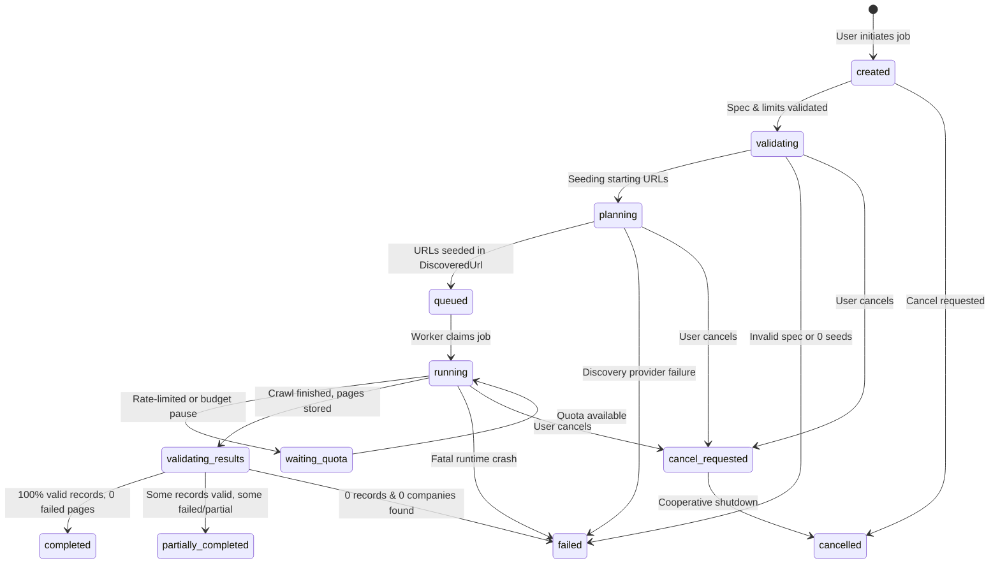
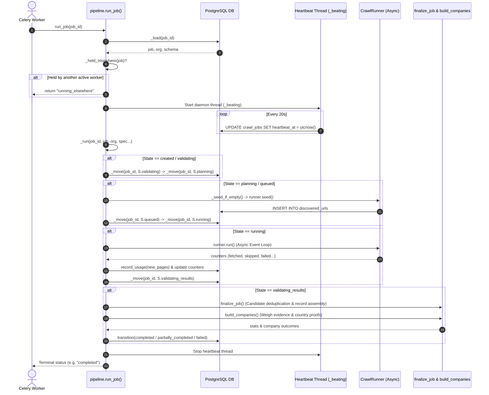

# Architecture & Technical Deep-Dive: Heimdallr Pipeline (`pipeline.py`)

## 1. Overview & Core Purpose

`backend/app/services/pipeline.py` is the **central orchestrator and state-machine driver** for crawl and data-extraction jobs in Heimdallr.

Its primary responsibility is taking a job end-to-end through distinct, audited lifecycle phases:
```
created ➔ validating ➔ planning ➔ queued ➔ running ➔ validating_results ➔ completed | partially_completed | failed | cancelled
```

### Key Design Pillars
1. **Re-entrant & Crash-Resilient**: Designed to survive sudden worker failures, container restarts, or Celery task redeliveries. Every step checks the persisted database state before executing and resumes exactly where work stopped.
2. **Double-Execution Prevention**: A background heartbeat mechanism actively locks ownership of the job in PostgreSQL. If another worker attempts to pick up a job currently in progress, it cleanly backs off.
3. **Strict Tenancy & Audit Trail**: Every database transaction is scoped to an organization (`org_id`) using row-level security. Every state change is recorded with an audit event in `crawl_job_events`.
4. **Usage & Billing Precision**: Tracks fetched page counts across retries so customers are billed exactly once per page fetched, even if a job is interrupted and resumed multiple times.
5. **Decoupled Discovery & Extraction**: Separates initial provider discovery/seeding, polite web crawling, page-level deterministic candidate extraction, entity synthesis, and company-level fact resolution.

---

## 2. Job Lifecycle & State Transitions

The pipeline moves a `CrawlJob` through sequential states governed by `app.services.state_machine`.



### State Machine Transition Rules

| Step | State | Purpose & Action | Next State on Success | Next State on Failure |
| :--- | :--- | :--- | :--- | :--- |
| **0** | `created` | Job created by API / CLI. | `validating` | `failed` / `cancelled` |
| **1** | `validating` | Validates extraction schema against org limits (`validate_spec`). | `planning` | `failed` |
| **2** | `planning` | Executes discovery providers (Wikidata, SEC, SearXNG, etc.) to seed URLs. | `queued` | `failed` (if 0 eligible URLs) |
| **3** | `queued` | Pre-flight check ensuring seed URLs exist before starting crawler. | `running` | `failed` |
| **4** | `running` | Executes `CrawlRunner.run()`: fetches pages, respects robots.txt, extracts candidates. | `validating_results` | `failed` / `waiting_quota` |
| **5** | `validating_results` | Aggregates page candidates into records (`finalize_job`) and resolves company proof (`build_companies`). | `completed` or `partially_completed` | `failed` (if 0 records/outcomes) |
| **-** | `cancel_requested` | User requested job cancellation while in progress. | `cancelled` | - |

---

## 3. High-Level Execution Flow

When Celery picks up a background task, it calls `run_job(job_id)`. Below is the complete sequence diagram:



---

## 4. Deep-Dive: Key Components & Functions

### 4.1 Proof of Life: Heartbeat & Distributed Mutual Exclusion

```python
HEARTBEAT_EVERY = 20.0  # seconds between proofs of life while a worker holds a job
HEARTBEAT_FRESH = timedelta(seconds=90)  # younger heartbeat means a worker is active
```

#### `_beating(job_id: uuid.UUID, org_id: uuid.UUID, every: float = 20.0)`
A Python context manager that runs a background daemon thread (`heartbeat-{job_id}`).
- Updates `crawl_jobs.heartbeat_at = utcnow()` every 20 seconds.
- Swallows individual database write exceptions (`except Exception: log.warning(...)`) to ensure a transient database stutter never halts a running crawl.
- Joins and terminates cleanly on exiting the context manager.

#### `_held_elsewhere(job: CrawlJob) -> bool`
Prevents split-brain crawls when messages are redelivered:
- Checks if the job is currently in an active state (`validating`, `planning`, `queued`, `running`, `waiting_quota`, `validating_results`).
- Checks if `job.heartbeat_at` was updated within the last 90 seconds (`HEARTBEAT_FRESH`).
- If active, `run_job` returns `"running_elsewhere"` and does nothing.

---

### 4.2 State Machine Management & Cancellation

#### `_move(job_id, org_id, dst: JobState, message="", **fields) -> CrawlJob | None`
Performs atomic updates to advance the job state using optimistic locking and logging:
- Checks whether `job.state == dst.value`. If yes, returns the job immediately (idempotent no-op).
- **Graceful Cancellation Handling**:
  If a user clicked cancel while the step was executing (`job.state == cancel_requested`):
  - If target state is `failed`, it transitions directly to `cancelled`.
  - Otherwise, it raises `JobCancelled()`, causing the pipeline to exit cleanly and mark the job `cancelled`.
- Invokes `app.services.state_machine.transition(...)` which increments `lock_version`, updates timestamps, and creates an audit entry in `crawl_job_events`.

#### `_cancelled(job_id: uuid.UUID, org_id: uuid.UUID) -> None`
Helper that safely transitions a job from `cancel_requested` to `cancelled`.

---

### 4.3 URL Discovery & Seeding

#### `_seed(r: CrawlRunner) -> int`
Asynchronous helper that invokes `await r.seed()` and guarantees cleanup of HTTP client connections in its `finally` block:
```python
async def _seed(r: CrawlRunner) -> int:
    try:
        return await r.seed()
    finally:
        await r.client.aclose()
```

#### `_seed_if_empty(job_id, org_id, runner) -> bool`
- Queries `discovered_urls` for the job. If URLs already exist, skips discovery (preserves previously discovered URLs across retries).
- If empty, runs `runner.seed()`, querying configured discovery providers (e.g. Wikidata, SEC Edgar, SearXNG, Linkup, Tavily).
- Validates that at least one URL has `status == UrlStatus.queued`.
- **Diagnostics on failure**: If 0 starting URLs are eligible (for example, if every seed URL hit an SSRF guard, a private subnet, or robots.txt disallow), it collects up to 5 rejection reasons from `status_reason`, transitions the job to `failed`, and logs an error such as:
  ```
  "No eligible starting pages (http://169.254.169.254: blocked destination; http://localhost: loopback blocked)"
  ```

---

### 4.4 The Crawl Execution & Usage Accounting

When entering `S.running`:
1. **Instantiation**: Creates a `CrawlRunner` with the job's spec, DNS resolver, Redis connection, and max record limits.
2. **Execution**: `asyncio.run(r.run())` handles asynchronous page fetching, politeness rate limiting, robot rules, content parsing, and per-page candidate extraction.
3. **Accurate Usage Tracking**:
   ```python
   billed = (job.counters or {}).get("pages_billed", 0)
   new_pages = max(0, counters.get("fetched", 0) - billed)
   if new_pages:
       record_usage(db, org_id, "pages", new_pages, job_id=job_id)
   counters = {**counters, "pages_billed": billed + new_pages}
   ```
   **Why this matters**: If a job fetched 50 pages and then worker power failed, on restart the runner might fetch 20 more. It only bills `70 - 50 = 20` pages, ensuring zero double-billing.

---

### 4.5 Post-Crawl Processing: Finalization & Company Proofs

When entering `S.validating_results`:

#### 1. Candidate Aggregation (`finalize_job`)
- Gathers all `FetchedPage.candidates` generated by deterministic extractors.
- Groups pages by entity domain or URL.
- Merges candidates into clean, deduplicated `ExtractedRecord` entries.
- Preserves manual user overrides if the record was previously edited (`user_edited == True`).

#### 2. Company Synthesis & Evidence Weighting (`build_companies`)
- For jobs investigating companies (especially technology adoption or vendor research), evidence gathered during discovery, crawl, SEC filings, and page text is unified in `JobCompany`.
- Outlines distinct outcomes:
  - `delivered`: Confirmed/Likely usage, verified in requested country, filter criteria passed.
  - `country unconfirmed`: Proof exists, but location could not be verified.
  - `elsewhere`: Proof exists, but company is based in an unrequested country.
  - `filter not met`: Failed specified schema filters (e.g. employee count or industry).
  - `weak proof`: Mere mention without affirmative product usage.
  - `no proof`: Company crawled, but no evidence was found.

#### 3. Terminal Status Assignment
```python
complete = stats["records"] > 0 and failed_pages == 0 and stats["invalid"] == 0
if stats["records"] == 0 and not outcomes:
    # Fail if completely empty
    transition(db, job, S.failed, "No records could be extracted", ...)
    return S.failed.value

dst = S.completed if complete else S.partially_completed
```
- Returns `completed` if all records are valid and zero pages failed.
- Returns `partially_completed` if some records succeeded despite non-fatal page failures or partial fields.
- Records rich metadata in the job event message (e.g. `"14 delivered; companies: 14 delivered, 2 elsewhere; 18 records (16 valid, 2 partial); 1 page(s) failed"`).

---

### 4.6 Diagnostics & Version Tracking

#### `code_version() -> str | None`
- Runs `git rev-parse --short=7 HEAD` with a 5-second timeout.
- Cached with `@functools.lru_cache(maxsize=1)`.
- Guarantees every job record in the database knows the exact Git commit SHA that executed it, aiding post-mortem debugging.

#### `settings_snapshot() -> dict`
- Captures runtime environment settings at the moment of execution:
  - `code_version`
  - `respect_robots`
  - `per_domain_delay_seconds`
  - `per_domain_concurrency`
  - `user_agent`
  - `max_page_bytes`

---

## 5. Resiliency & Fault-Tolerance Matrix

| Failure Scenario | How `pipeline.py` Handles It |
| :--- | :--- |
| **Worker crashes midway through crawling** | Celery or supervisor re-enqueues job. On rerun, `_run()` sees state is `running`, resumes runner, and checkpoints from the last fetched page in PostgreSQL. |
| **Duplicate Celery task delivery** | `_held_elsewhere()` detects active heartbeat within 90s, logs warning, and exits cleanly with `"running_elsewhere"`. |
| **User cancels job while crawling** | `_move()` detects `cancel_requested`, halts execution, raises `JobCancelled`, and transitions job to `cancelled`. |
| **Worker loses DB connectivity briefly** | Heartbeat thread catches exception and logs a warning so temporary database blips do not abort the job. |
| **Invalid Schema Spec** | `validate_spec` catches error before any crawl work occurs, moves job to `failed`, and logs human-readable reason. |
| **All start URLs blocked (SSRF or Robots)** | `_seed_if_empty()` validates that `eligible > 0`. If 0, marks job `failed` with exact reasons (e.g., SSRF guard rejection). |
| **Unexpected Python Exception** | Caught by top-level `except Exception:`, logs full stack trace, records an `error` event in `CrawlJobEvent`, and transitions job to `failed`. |

---

## 6. Summary of Exports & Helpers

| Name | Kind | Purpose |
| :--- | :--- | :--- |
| `run_job(job_id, ...)` | Function (Public API) | Entry point executed by Celery tasks or CLI to run or resume a job. |
| `_run(...)` | Function (Internal) | Core state-machine dispatcher evaluating each phase sequentially. |
| `_beating(...)` | Context Manager | Starts/stops daemon thread sending 20s database heartbeats. |
| `_held_elsewhere(job)` | Function | Determines if another worker task currently holds an active lease on the job. |
| `_load(job_id)` | Function | Loads `CrawlJob`, `Organization`, and `ExtractionSchema` bypassing tenant checks. |
| `_move(job_id, org_id, dst, ...)` | Function | State machine transition wrapper with cancellation and idempotency guards. |
| `_seed(runner)` | Async Function | Runs discovery seeding and ensures HTTP client teardown. |
| `_seed_if_empty(...)` | Function | Seeds initial URLs if table is empty; validates eligible URL counts. |
| `code_version()` | Function (Cached) | Returns current Git commit SHA for auditability. |
| `settings_snapshot()` | Function | Returns crawler configuration snapshot. |
